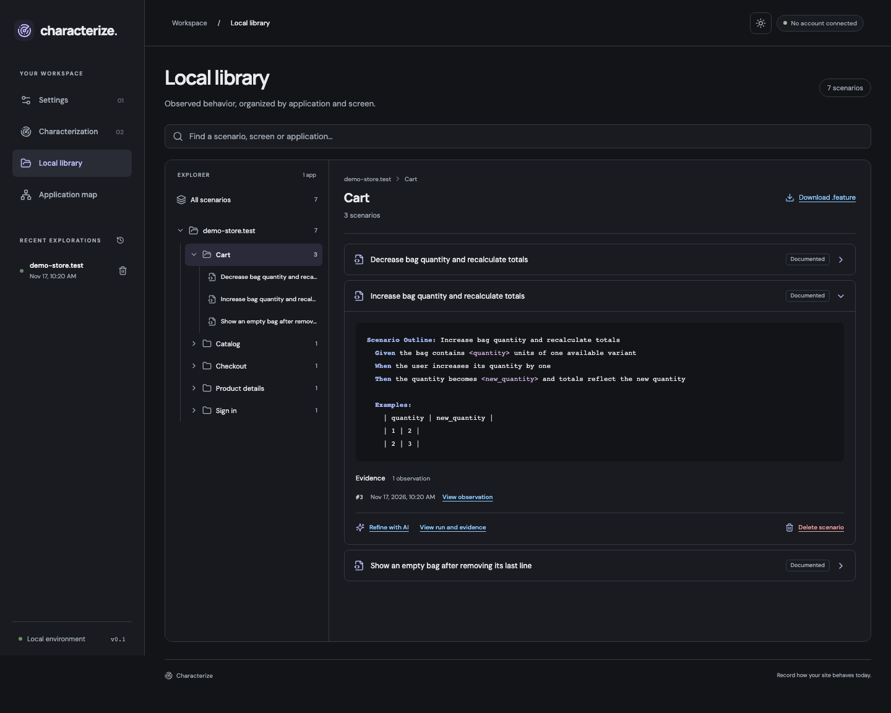

# Characterize

**Document application behavior from browser journeys.** Give Characterize a starting URL and a flow to explore. An AI agent drives Chromium through Playwright MCP, records business rules as it discovers them, and writes tests for the behavior it observes.

[Quick start](#quick-start) · [Local library](#local-library) · [Application map](#application-map) · [Recovery](#exploration-and-recovery) · [Coverage](#coverage)



*Local library with demo data.*

## Quick start

Use Node.js 22.18 or later and npm on macOS or Linux. From the project directory, run:

```sh
npm ci
npm run setup:browser
npm run dev
```

Open [the local workspace](http://127.0.0.1:4320). Connect **one Codex, Claude or GitHub Copilot account** in Settings. The official clients use private application sessions instead of importing your personal CLI sessions. Copilot opens GitHub in the browser where you click Connect; **Open sign-in** is available if the popup is blocked. If Copilot asks which account to use or requests permission to store a credential without encryption, answer in Settings. Authorization is not complete until the provider confirms the connection. You can cancel a pending login or disconnect this application's account without logging out of your personal tools. Copilot sign-in expires after ten minutes.

## Your first exploration

1. **Pick a site.** For a first run, start `npm run demo` in another terminal and enter [the local demo URL](http://127.0.0.1:4321) in Characterization.
2. **Give the agent a task.** Try “Open the catalog, apply a filter and describe how the product list changes.” Choose a coverage level, model and reasoning effort. Optional context can include written instructions and local directories containing skills or guardrails.
3. **Watch the journey.** Follow the actions as they arrive. The agent may follow redirects within the same registrable domain, including subdomains. When a flow leads to another domain, it records the destination and returns to the original site.
4. **Review the evidence.** Open **Local library** to browse scenarios and their observations, or **Application map** to explore screens, components and services. Open a recording's diagnostics for failed actions and its local Playwright Trace Viewer when a trace is available.
5. **Run the tests.** Download the suite ZIP from a completed exploration and review its TypeScript assertions. In the extracted directory, run `npm install`, `npx playwright install chromium` and `npm test` to verify the generated suite.

## Local library

Browse application and screen folders on the left; select a folder or scenario to see its Gherkin, evidence and actions on the right. Search by application, screen, scenario name or step text. **Download .feature** exports the current selection. **Smoke** groups journeys spanning several screens. Repeated observations of the same behavior appear together, with links to their individual recordings.

Scenario titles and business clauses use English. Names identify the action, result or distinguishing condition: **Increase bag quantity and recalculate totals** and **Decrease bag quantity and recalculate totals** describe different behaviors. Before recording a rule, the agent compares names already used for the site and can rename an older broad title. Title changes preserve scenario identifiers, evidence and deletion choices, and appear in the library, Gherkin and exported report.

Data that drives a rule uses `<snake_case>` parameters in a **Scenario Outline**, with observed values in **Examples**. Incidental product names, localized button labels and page copy stay in the evidence or test locators. Observed samples do not establish untested cases.

### Refine with AI

Use **Refine with AI** beside a scenario's evidence and delete actions to describe an improvement. The exploration's AI provider reviews related scenarios from the same site, asks for missing details and proposes replacements. Compare the original and proposed Gherkin, choose which related scenarios to include, then save. Related changes require your selection; grouped observations are updated together.

Refinement updates the library and `.feature` downloads while retaining the original reports and evidence. **Generated Playwright tests need a separate review after a refinement.** Refining wording does not run the target application again.

## Application map

The map opens with **All screens**, **All entities**, **Rules** and **Services** enabled. It includes recorded screens, contained and shared components, interactive elements, business rules, services and operations. Its charcoal dark mode uses a lavender accent; light mode is also available.

- **Screen** narrows the map to a selected screen and its related entities. Choose **All screens** to return to the application view.
- **Detail** switches between screens, components and all entities. Rules and services can be toggled independently.
- **Select a node or connection** to inspect its details and evidence. Selection preserves the other entities, their positions and the current zoom.
- **Pan, zoom or use the minimap** to navigate. **Fit map** fits the current view; double-click a screen or use **Focus** to inspect its contents.

Enable **Generate service map** before exploring to capture browser destinations and operations. Select an operation to inspect captured results, durations and available action evidence. Partial captures show their limits. Gateways appear as observed destinations, and unknown route segments are grouped for privacy.

## Exploration and recovery

**Prioritize unexplored paths** uses documented scenarios, historical gaps and untried controls to guide the next exploration. The agent keeps decision points, backtracks to try sibling paths and saves each observed condition/action/outcome with `record_discovery`. Product, market, currency and other sample values belong to examples. Market-dependent rules retain their observed scope. Disable the option to recheck known flows.

During browser exploration, three minutes without provider output, browser evidence or recorded discoveries stops the worker. Once the discovery frontier is closed or the browser budget is reached, report preparation has its own ten-minute limit in addition to the browser time budget below. Copilot streams its response, and provider output is saved as it arrives, including when generation is interrupted. Recorded rules remain available in the library and graph when the final report is incomplete. The library groups repeated scenarios with matching clauses and screens, and keeps their individual observations accessible.

If the report was interrupted after rules were saved, open the recording and choose **Complete saved report**. Recovery keeps the same recording, evidence and business clauses. It generates tests in batches of up to four rules with medium reasoning effort, checkpoints every completed batch and resumes only missing batches after a further interruption. The original model and exploration settings are retained. Its recording tools can read and search existing evidence for prerequisites outside the current batch. Unsupported prerequisites or assertions are listed as gaps. Recovered tests remain pending review and execution.

## Coverage

| Level | What to explore | Action budget | Time budget |
| --- | --- | ---: | ---: |
| Smoke | Entry points and main flows | 30 | 8 min |
| Functional | Common user journeys | 80 | 20 min |
| Detailed | Variations, states and validation | 160 | 40 min |
| Exhaustive | Edge cases and alternative paths | 280 | 60 min |

Action budgets are maximum browser calls, including snapshots and failed attempts. They are not a target to fill with repeated actions. Before finishing, the agent reviews the discovery frontier and records why any remaining screens cannot be explored. Reports also retain measured pending and blocked controls when the provider ends without that review. Structured reports can be recovered when a provider surrounds valid JSON with explanatory text. Choose a visible browser if you need to sign in to the target site during exploration.

See [Gherkin quality and exploration findings](docs/characterization-quality.md) for the skills.sh references and the process changes.

## Local data

The server listens on loopback. Settings, run history, evidence, traces and Gherkin files live under `.data/`, which Git ignores. A fresh clone starts with an empty library. The theme follows your system on first visit, and the appearance button saves your choice in the browser.

**Remove from recent** hides a recording from recent history while keeping its scenarios and evidence. **Delete scenario** removes the scenario and its grouped observations from the library and Gherkin files; the original reports and evidence remain available.

The Characterization form saves its URL, instructions and agent options independently in `.data/characterization.json`, so clearing recordings does not reset the form or Settings.

Your selected AI provider receives the prompt, selected context and browser observations. **Review files** in Settings shows which context documents will be included. Provider credentials use private official-client stores under `.data/accounts/`, with restricted directory permissions. Do not share this directory. A connection made in Characterize can persist across restarts; global CLI sessions are not imported. Temporary Copilot authorization links are cleared when sign-in completes, fails or is cancelled. Traces and exported suites can contain page content and form data, so review them before sharing.

| Setting | Purpose |
| --- | --- |
| `PORT` | Change the local server port (default `4320`) |
| `CHARACTERIZE_DATA_DIR` | Choose a different data directory |

## Development

```sh
npm run typecheck
npm test
npm run build
npm run test:e2e
```

The browser tests use fixture data and run without an AI subscription. To serve the compiled application, run `npm start` after the build. The platform prefers CLIs available on your PATH and bundles pinned versions as a fallback.

[Design notes (Spanish)](docs/SDD.md) · [Validation notes (Spanish)](docs/validation.md) · [Playwright MCP](https://github.com/microsoft/playwright-mcp)
