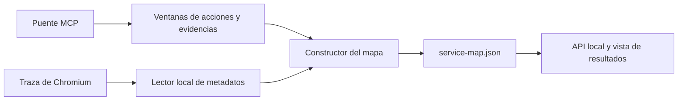

# SDD — Mapa de servicios observados desde el frontend

**Implementado · 15 de noviembre de 2026**

La representación actual vive en la pestaña Application map. El grafo incorpora pantallas, límites observados de componentes, elementos interactivos, navegaciones, reglas y operaciones de red. Los límites con el mismo rol y nombre funcional observados en varias pantallas se promueven a entidades compartidas. Las relaciones conservan referencias a las observaciones que las originaron. La agrupación describe la estructura visible de la interfaz.

La implementación usa trazas de formato 10. Conserva palabras conocidas de rutas, versiones y mayúsculas, sustituye IDs numéricos y UUID por `{id}` y agrupa los segmentos desconocidos bajo `{value}`. Esta regla conservadora puede agrupar endpoints con nombres poco habituales. La asociación con acciones requiere concordancia entre los relojes de la traza y la petición dentro de 100 ms, una única ventana MCP y una única página observada en ella. Los resultados históricos mantienen su comportamiento original hasta que se ejecute una exploración con la opción activada.

## Qué podrá responder una exploración

Al revisar un recorrido, la persona que lo ejecutó podrá ver qué destinos HTTP(S) consultó el navegador, desde qué pantalla, mediante qué operaciones y con qué resultado. Cada relación tendrá al menos una petición de respaldo. La unidad de entrega será una exploración, incluso cuando falle la generación de tests.

Por ejemplo, al abrir la ficha de un pedido y pulsar «Ver envío», el mapa podría mostrar lo siguiente. Los datos son ilustrativos.

| Pantalla | Destino observado | Operación | Resultado | Asociación con la acción |
| --- | --- | --- | --- | --- |
| Detalle de pedido | `api.tienda.test` | `GET /orders/{id}/shipment` | 200 · 84 ms | Durante el clic, evidencia #12 |
| Detalle de pedido | `events.proveedor.test` | `POST /collect` | 204 · 31 ms | Fuera de una acción |

La primera fila permite localizar la API que sirvió los datos de envío. Si esa API es una pasarela, la identidad de sus servicios internos queda abierta. Para dibujar un salto entre dos servicios haría falta otra fuente, como spans de servidor con una relación padre-hijo. También puede haber pantallas renderizadas en servidor cuya carga solo deje una petición de documento.

## Experiencia y alcance

- En el formulario de exploración, añadir **Generar mapa de servicios** con valor inicial desactivado. La ayuda explicará que la opción procesa la red de la traza de diagnóstico local. El interruptor controla la creación del mapa. Actualmente el diagnóstico ya intenta grabar una traza en cada ejecución.
- En el resultado, abrir **Mapa de servicios** para ver las conexiones entre pantallas y orígenes. Seleccionar una conexión abre una tabla con método, ruta normalizada, número de llamadas, estados HTTP y fallos de transporte. Una fila se despliega hasta las observaciones individuales y, cuando exista, la evidencia de la acción. La tabla también permitirá recorrer todo el resultado con teclado.
- La vista inicial mostrará `fetch` y `xhr`. Los documentos tendrán un filtro propio para revisar navegaciones y formularios de envío tradicional. Un selector permitirá incluir destinos externos. Los contadores indicarán qué quedó fuera por filtro, por tipo de recurso o por límites de lectura.
- La primera entrega cubrirá el Chromium de la exploración en modo visible y en headless. El mapa estará disponible al finalizar. La comparación entre ejecuciones, los mensajes de WebSocket, el contenido de streams y la topología interna quedan para versiones posteriores. El puente ya bloquea los service workers, por lo que esta vista describe ese entorno de ejecución.

## Fuente y recorrido de los datos

El puente `server/mcp-proxy.mjs` inicia el trazado antes de delegar la primera llamada admitida al MCP oficial. Registra la evidencia numerada en `evidence.jsonl` e intenta cerrar la traza al salir. `server/diagnostics.ts` ya reconoce los archivos `traces/trace-*.network`. El inventario se puede obtener después de la exploración, sin pedir más acciones al agente ni repetir peticiones. El Trace Viewer documenta la inspección de las solicitudes de red por acción. El formato en disco se tratará como una dependencia de la versión instalada. [Documentación de Playwright Trace Viewer](https://playwright.dev/docs/trace-viewer#network)

1. **Preparación.** Añadir `serviceMapEnabled` a `runInputSchema`, con valor por defecto `false`. `Runs.start` fijará la elección en la ejecución y en `bridge.json`. Un historial antiguo sin ese campo se leerá como desactivado. Abrir el historial nunca generará mapas retroactivos.
2. **Registro de la acción.** Cuando el mapa esté activado, el puente añadirá a la evidencia el inicio y fin de la llamada delegada, junto al ID actual. Usar tiempo UTC de pared comparable a `startedDateTime` y guardar el ID aunque la acción falle. El campo `at` existente solo refleja el momento de escritura. Registrar también el resultado de cierre del trazado en un marcador local escrito atómicamente después de `browser_stop_tracing`.
3. **Lectura.** Un módulo nuevo `server/service-map.ts` recorrerá por streaming los archivos de red del directorio validado de esa ejecución. Admitirá solo archivos regulares con nombre esperado y sin enlaces simbólicos. Para cada `resource-snapshot` válido proyectará los campos del contrato inferior. Para identificar la pantalla, leerá de la traza asociada solo las referencias de página, frame principal, URL y tiempos de las observaciones. Nunca abrirá los blobs de `resources/`.
4. **Publicación.** Al terminar el proveedor, `server/runs.ts` coordinará el cierre del puente y dará al marcador un plazo acotado de cinco segundos. En cancelaciones o cierres forzosos podrá faltar. El constructor publicará el resultado con `saveJSON` dentro de `Store.runDir(id)`. Un fallo de lectura quedará en el estado del mapa y permitirá completar la finalización normal de la ejecución.
5. **Recuperación.** Si el servidor se reinicia durante la captura o el análisis, la recuperación de `Store` seguirá marcando la ejecución interrumpida. Tras inicializar el gestor, encolar una sola reconstrucción por ejecución activada sin resultado terminal, usando las líneas completas disponibles. Publicar por reemplazo, nunca acumular sobre el resultado anterior. Consultas simultáneas leerán el mismo artefacto.

## Identidad, atribución y recuentos

| Elemento | Regla de construcción |
| --- | --- |
| Destino o «servicio observado» | Un nodo por origen HTTP(S) canónico, incluido el puerto efectivo. Dos prefijos de la misma pasarela aparecen como operaciones del mismo nodo. `sameDomain` clasifica «mismo dominio» y «externo» según el sitio inicial. Esta etiqueta describe el dominio, no la propiedad del servicio. |
| Operación | Clave compuesta por origen, método en mayúsculas y ruta normalizada. Conservar mayúsculas de la ruta y versiones como `/v1`. Quitar usuario, contraseña, query y fragmento. Sustituir segmentos numéricos, UUID y valores opacos o sensibles por marcadores. Un segmento dudoso se agrupa bajo `{valor}`. Versionar estas reglas y aplicar la misma proyección a las rutas de pantalla. |
| Pantalla | Usar la última ubicación conocida del frame principal de la misma página al inicio de la petición. Traducirla con las reglas de `server/screens.ts` y normalizar la clave y la etiqueta antes de guardarlas. Una petición de navegación puede preceder al primer snapshot. Usar «Pantalla sin identificar» cuando falte ubicación fiable, también ante un cambio de ruta SPA ambiguo. |
| Acción | Asociar únicamente si el inicio de la petición cae en una sola ventana MCP y se puede vincular esa ventana a la misma página mediante las observaciones. Ante pestañas indistinguibles, relojes incoherentes o ventanas solapadas, omitir el ID y conservar la petición. La etiqueta «durante la acción» expresa coincidencia temporal. Una petición de sondeo también puede coincidir con un clic. |
| Recuento | Cada registro de petición aceptado cuenta una vez. Reintentos y saltos HTTP visibles cuentan por separado. Los filtros operan sobre esas mismas observaciones antes de agregar. Un 404 o 503 cuenta como respuesta HTTP. Registrar un fallo de transporte solo si la fuente señala fallo, y resultado desconocido si faltan ambos datos. Duración desconocida se guarda como `null`. |

Para `POST /graphql`, la operación visible será ese método y esa ruta. Una misma operación puede agrupar varias consultas GraphQL, llamadas que difieren por query o rutas que se normalizaron igual. El detalle explicará la agrupación para que el usuario pueda interpretar el recuento.

## Persistencia y API

Guardar un único `service-map.json` versionado por ejecución, con permisos privados. El contrato mínimo será el siguiente.

| Campo | Contenido |
| --- | --- |
| `schemaVersion`, `runId`, `state` | Versión del contrato, ejecución y estado del análisis |
| `coverage` | Motivos acotados de cobertura parcial, registros examinados, incluidos y descartados por causa |
| `screens`, `services`, `operations` | Diccionarios con identificadores estables dentro del artefacto y etiquetas normalizadas |
| `observations` | ID local reproducible por archivo y posición, referencias a operación y pantalla, tipo de recurso, instante relativo al inicio, estado HTTP o fallo, duración y `evidenceId` opcional |

Las aristas y sus contadores se derivarán agrupando observaciones por pantalla y destino. El constructor proyectará solo esos campos. Cuerpos, cabeceras, cookies, valores de query, títulos de página y mensajes de error libres quedan fuera del índice, de los logs del analizador y de la respuesta API. Los nombres de host y los segmentos de ruta conservados siguen siendo datos locales del sitio. La traza original tiene su propio contenido y acceso desde Diagnóstico. El mapa se mantendrá fuera del prompt del proveedor y del ZIP de tests.

Ampliar `POST /api/runs` con la opción y añadir `GET /api/runs/:id/service-map` bajo las comprobaciones existentes de Host, Origin y `x-characterize`. Para una ejecución conocida, devolver 200 con estado y contadores, y con los datos cuando estén disponibles. Una ejecución inexistente devuelve 404. El listado de historial llevará solo el indicador de disponibilidad.

| Estado del mapa | Condición y presentación |
| --- | --- |
| `disabled` | Opción desactivada o campo ausente en una ejecución histórica |
| `pending` | Exploración activa o análisis en curso |
| `ready` | Fuente compatible, cierre confirmado y lectura completa. Cero operaciones es un resultado válido e indica que no se observaron solicitudes de los tipos incluidos |
| `partial` | Se pudo leer parte de la fuente y hubo interrupción, líneas inválidas o truncamiento. Mostrar los datos disponibles y el motivo |
| `unavailable` | Fuente ausente, ilegible o incompatible. Indicar el motivo en vez de presentar un grafo vacío |

Presupuesto inicial propuesto por ejecución: 64 MiB de lectura total de trazas, 1 MiB por línea y 10.000 observaciones retenidas. Leer por bloques, descartar hasta el próximo salto de línea si una línea excede el máximo y detener la lectura al alcanzar un límite global. Marcar `partial`, indicar el límite alcanzado y expresar los totales como «observados hasta el límite». Validar estos valores con la fixture de carga antes de fijarlos.

## Entrega y criterios de aceptación

| Paso | Trabajo y prueba de salida |
| --- | --- |
| 1. Validar la fuente | Extender `tests/e2e/bridge.spec.ts` con una página local que haga un fetch durante un clic y otro después, más una segunda pestaña. Capturar con el MCP y Chromium instalados. Comprobar tipo de recurso, reloj, referencia de página/frame, estado, duración y señal de cierre. Si falta identidad de página, se entrega la operación sin atribución. Conservar una fixture sintética del formato para detectar cambios al actualizar Playwright. |
| 2. Construir el inventario | Implementar lector, normalización y agregación. Probar dos pedidos con IDs distintos, dos puertos del mismo host, un tercero, 302, 404, conexión abortada, recurso estático y `POST /graphql`. Verificar recuentos exactos y ausencia de un secreto centinela insertado en query, ruta, cabecera y cuerpo. |
| 3. Integrar ciclo de vida y API | Probar una captura desactivada, un historial antiguo, una traza válida vacía, cancelación con última línea truncada, ausencia de traza y reinicio durante publicación. Dos reconstrucciones con las mismas entradas deben producir los mismos IDs y totales. Verificar que un fallo del constructor conserva el informe y la suite de una exploración completada. |
| 4. Entregar la experiencia | Añadir opción y acceso desde `src/main.tsx`, con una vista de mapa y detalle. Desde el clic de la fixture se debe poder localizar la operación, abrir su petición y llegar a la evidencia correcta. La llamada posterior queda sin acción y el tráfico de la segunda pestaña conserva su procedencia. Probar filtros, teclado, pantalla estrecha, estados vacíos y resultados parciales. |

La validación de entrega usará `npm run typecheck`, `npm test`, `npm run build` y `npm run test:e2e`. Las pruebas del puente y de la interfaz usarán servidores locales y prescindirán de una cuenta de IA.
