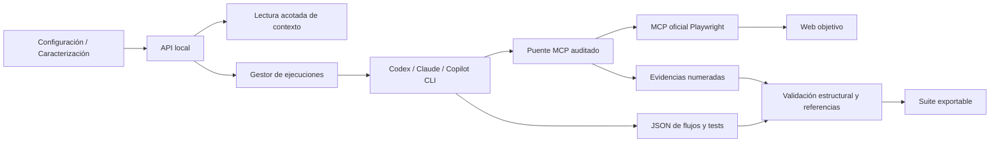

# SDD — Characterization Platform

Estado: implementación inicial local. Fecha: 2026-11-14.

## Objetivo

Una persona conecta su cuenta de IA y obtiene una suite Playwright que describe los comportamientos existentes de una web. Solo la conexión de un proveedor y una URL de ejecución son obligatorias. El contexto escrito, los directorios, el prompt, el modelo y el esfuerzo son opcionales.

Se toma Automation-platform como referencia de una herramienta local con proveedores oficiales, evidencia y separación entre generación y validación. Este repositorio es independiente; no modifica ni importa su estado privado.

## Experiencia

- Configuración: tres proveedores, login externo, estado de sesión, contexto escrito, directorios y previsualización de archivos.
- Caracterización: URL, prompt, cobertura, proveedor, modelo y esfuerzo, navegador visible opcional.
- Resultado dentro de la segunda pantalla: progreso por acciones MCP, cancelación, flujos, pasos, resultados, evidencia, código, límites y descarga ZIP.
- Historial persistente con estados `running`, `completed`, `failed`, `cancelled`, `interrupted`.
- Pestaña Application map con grafo de pantallas y componentes anidados, entidades compartidas, controles, navegaciones, reglas y servicios observados. La biblioteca presenta escenarios y referencias de evidencia.
- Descubrimiento incremental con `record_discovery` y plan de alternativas mediante `get_discovery_plan`. Los hallazgos persisten antes de generar el informe final. El plan conserva los controles pendientes al volver a una pantalla y actualiza sus referencias.
- La exploración documenta capacidades y reglas observables. Los valores de producto y mercado se guardan como ejemplos y las reglas dependientes del mercado conservan ese alcance. El presupuesto acota la exploración y cada estado o resultado distinto puede producir un escenario.

`completed` significa informe y tests generados con referencias válidas a acciones observadas. No significa que los tests hayan pasado.

## Arquitectura

React + TypeScript + Vite para la interfaz; Express sobre Node para el servidor local. Un solo origen HTTP sirve UI y API. JSON privado con reemplazo atómico mantiene la configuración y cada ejecución. No se requiere nube propia ni base de datos externa.

Cada ejecución fija una copia del contexto, el prompt, límites, configuración MCP y esquema de salida. Las CLI se lanzan con argumentos, sin shell. El gestor limita salida, tiempo y concurrencia a una ejecución, y termina el grupo de procesos al cancelar.

El puente enumera solo navegación e interacción de Playwright: no expone ejecución de JavaScript arbitrario, comandos del sistema, carga de archivos ni herramientas WebMCP suministradas por páginas. Registra respuestas y añade IDs de evidencia para que el modelo pueda citarlos. No modifica los contextos originales.

## Proveedores

| Proveedor | Login                          | Ejecución                                                            | Salida                                      |
| --------- | ------------------------------ | -------------------------------------------------------------------- | ------------------------------------------- |
| Codex     | `codex login` y `login status` | `codex exec`, MCP por configuración de invocación, sandbox read-only | Esquema JSON y archivo de respuesta final   |
| Claude    | `claude auth login/status`     | Print mode, restricted, sin herramientas nativas, MCP estricto       | `structured_output` validado                |
| Copilot   | `copilot login --web-flow`     | Prompt mode, herramientas restringidas, MCP por invocación           | JSON pedido en prompt, validado en servidor |

La selección de modelo se pasa literalmente. Los errores de disponibilidad/esfuerzo quedan visibles. Codex consulta `model/list` mediante el app-server sin inferencia; otros proveedores admiten ID manual. El historial no almacena tokens de login.

## Contexto

Rutas absolutas, recursión de seis niveles, 80 documentos, 24 KB por archivo y 120.000 caracteres en total; como máximo 3.000 entradas visitadas. Se excluyen dependencias, Git, binarios, nombres de secretos y symlinks. Se calcula SHA-256 por documento. La lista y las exclusiones por límites se muestran antes de ejecutar.

El contexto se trata como instrucciones de alcance subordinadas al contrato del agente. Las páginas web son datos observados. Estos límites reducen exposición accidental, pero no son una garantía de detección de secretos dentro de documentos: el usuario selecciona el contexto que quiere enviar al proveedor.

## Contrato de navegación

El alcance es el dominio registrable con sufijos privados, no el origen exacto. Se admiten subdominios, rutas, protocolo y puertos del mismo dominio.

Las salidas externas observadas deben aparecer como flujos con evidencia; el servidor rechaza un informe que no cite la evidencia de una salida. Se permite observar el destino y regresar, pero no seguir interactuando allí. Se examinan la página actual y las URLs de pestañas que informa Playwright, incluidas nuevas ventanas. Cargar recursos, redirecciones y páginas no equivale a aislamiento de red. Una redirección asíncrona posterior al último snapshot necesita una nueva observación; no se promete un registro completo de cada salto HTTP intermedio.

## Seguridad y operación

- Bind en `127.0.0.1`, validación exacta de Host y Origin y cabecera API obligatoria, sin CORS abierto.
- Configuración, contexto y evidencia privados fuera de Git; JSON de escritura atómica y nombres de ejecución UUID.
- Ningún test generado se ejecuta automáticamente con privilegios del servidor. La suite se descarga para revisión y ejecución separada.
- Sin `--yolo`, bypass de sandbox ni ejecución de scripts de skills.
- Una ejecución interrumpida por reinicio se marca `interrupted`, nunca completada.
- El login de la cuenta de IA y el de la web objetivo son sesiones distintas.

## Límites de esta versión

No incluye replay automático de la suite generada, navegador persistente de la web objetivo, pausa/reanudación, colas concurrentes, selección gráfica de carpetas ni métricas porcentuales de cobertura. No automatiza MFA ni CAPTCHA. No se certifica compatibilidad Windows en esta implementación de supervisión POSIX. Las sesiones Claude y Copilot necesitan validación con una cuenta del usuario.

La fidelidad semántica de los tests sigue necesitando revisión y ejecución: un ID de evidencia válido no prueba por sí solo que cada aserción refleje ese resultado.
